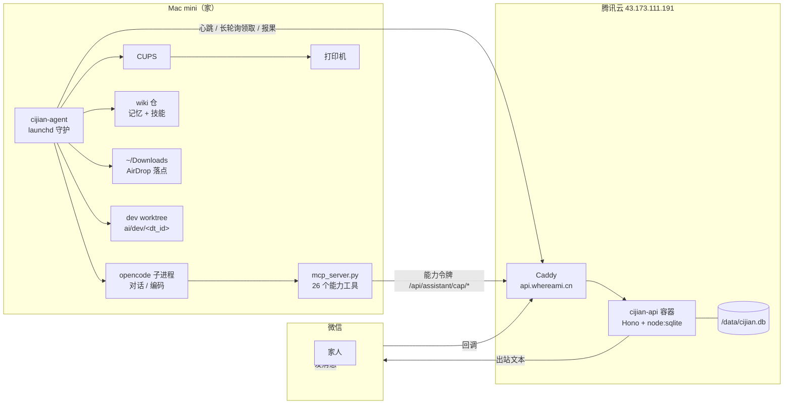
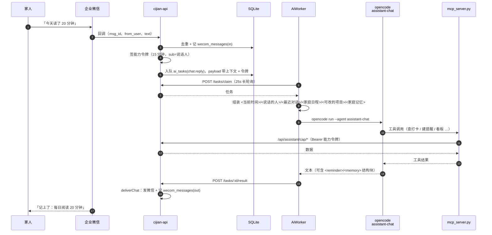
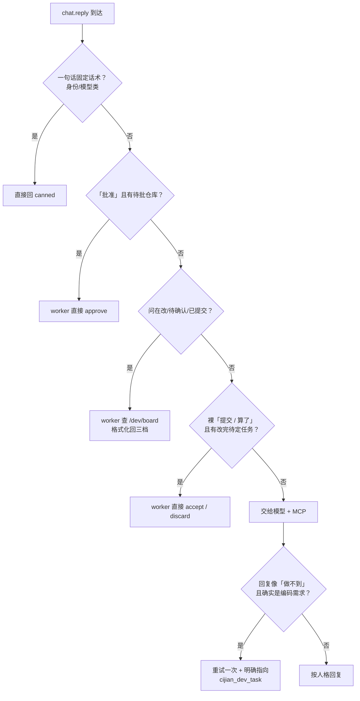
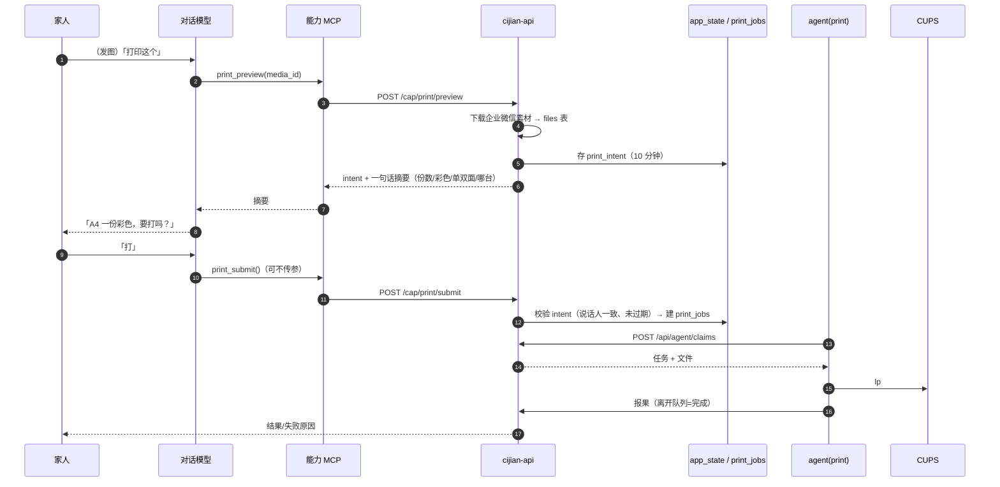
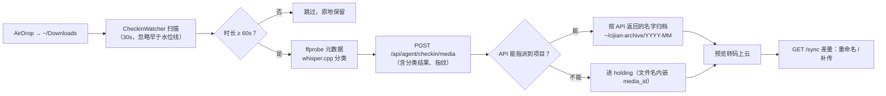
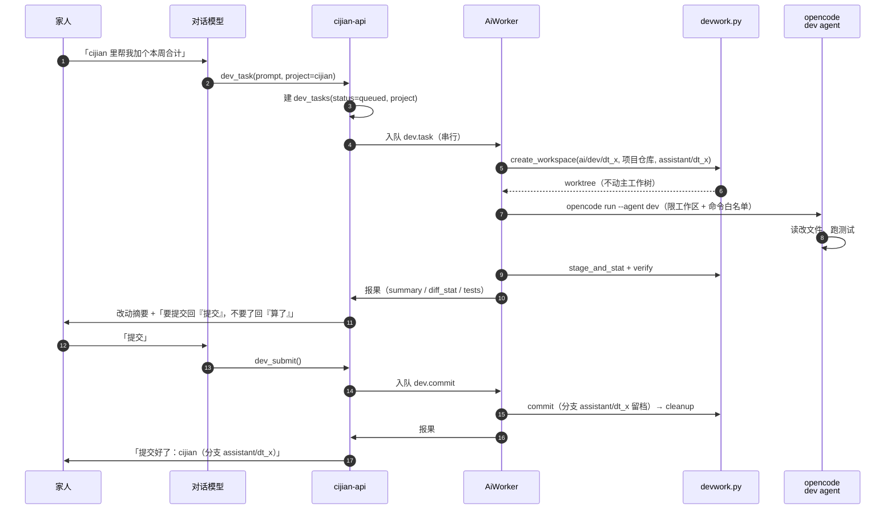
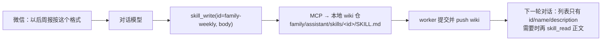

# 此间家庭助手 · 架构与流程

> 更新：2026-11-15 · 状态：现行（对应 cijian-agent v0.3.6）
> 相关：`docs/13-ai-agent-plan.md`（AI 任务平面）、`docs/14-assistant-plan.md`（助手/编码通道设计）

## 0. 一句话

家里人在微信里说一句话，**服务器**负责认人、排队、落数据和回消息，**家里的 Mac mini**负责真正干活（打印、跑模型、改代码、归档打卡）；两边只通过 HTTP 任务队列协作，agent 不需要公网入口。

## 1. 三个参与方与三种身份

```
家庭用户（微信）  ──消息──▶  企业微信  ──回调──▶  cijian-api（公网 HTTPS）
                                                    ▲        │
                                             长轮询领取     │ 直接回微信
                                                    │        ▼
                                              cijian-agent（Mac mini，launchd 守护）
```

| 身份 | 谁持有 | 能做什么 | 有效期 |
|---|---|---|---|
| **家庭用户身份** | 微信 userid（`wecom_users`，role=`dad`/`mom`/…） | 决定「谁在说话」：查谁的数据、谁能批仓库 | 常驻 |
| **agent key** | `~/.config/cijian/agent.env`，只在本机 | 心跳、领取任务、报果、拉素材/打卡同步 | 长期，可吊销 |
| **能力令牌（cap token）** | API 每次入队对话任务时临时签发，塞进 payload | 只用于 `/api/assistant/cap/*`，代表「某个说话人」 | 15 分钟（打印凭条 10 分钟） |

**为什么要有能力令牌**：对话进程（opencode 子进程）不拿 agent key，也不拿数据库。它拿到的只是一枚「只代表这个人、只能调这些接口、15 分钟就过期」的临时票。这样模型/MCP 被带偏也越不了权。

**三权分立**：
- 对话模型没有文件、shell、网络权限，只能调 MCP 暴露的 26 个家庭能力；
- 编码模型只能读写自己那套 worktree，命令走白名单；
- 真正的 commit / push、状态落库、发消息，全部由 worker 或 API 做。

## 2. 部署拓扑

| 组件 | 位置 | 形态 | 说明 |
|---|---|---|---|
| `cijian-api` | 腾讯云 `43.173.111.191` | Docker Compose `app-api-1`，宿主 Caddy 反代 | `https://api.whereami.cn`；SQLite `/data/cijian.db` |
| `cijian-agent` | 本机 Mac mini | launchd `com.cijian.agent` | handlers=`print,checkin,ai`；日志 `~/Library/Logs/cijian-agent.err.log` |
| 打印机 | Mac mini | CUPS `Mi_All_in_One_Inkjet_Printer` | agent 用 `lp` 提交、`lpstat` 跟踪 |
| 家庭 wiki | GitHub `cijian-family-wiki` | 本机克隆 `~/.local/share/cijian-agent/ai/wiki` | 记忆条目 + 技能（有历史、可回滚） |
| 企业微信 | 云端 | 应用回调 → API | 入站消息、出站文本 |



## 3. 代码模块

### 3.1 cijian-agent（Python 纯标准库）

| 模块 | 职责 | 关键点 |
|---|---|---|
| `agent.py` | 主进程：崩溃恢复 → 心跳线程 → 领取/处理循环 | 只跑 `print` 这类 claim 任务；错误绝不弄崩进程 |
| `registry.py` | `REGISTRY`（任务型 handler）/ `BACKGROUND`（能力型线程） | 心跳上报的能力列表 = 两者并集 |
| `client.py` | `ApiClient`：心跳、claim、报果、AI 平面、打卡 sync | 所有出站 HTTP 收敛在这里 |
| `config.py` | `agent.env` → `Config` 数据类 | 目录/超时/模型/白名单路径的单一来源 |
| `state.py` | 本地崩溃恢复状态（`state.json`） | 防重复打印：`phase=submitted` 只等出队，不重提 |
| `handlers/print.py` | `lp` 提交 + `lpstat` 轮询 + 打印机状态机 | 提交即成功；离开队列=完成 |
| `checkin.py` | 打卡管线（后台线程） | 扫描→ffprobe→whisper 分类→上报→归档→预览转码→sync |
| `ai/worker.py` | AI 任务消费与分派（`AiWorker.handle`） | 见 §3.2，是本仓最厚的一块 |
| `ai/runner.py` | opencode 子进程壳：准备 home/workspace、装 MCP、隔离配置、跑、抽文本 | `run`（对话/分析）、`run_dev`（编码） |
| `ai/devwork.py` | 编码通道工作区：项目白名单、worktree、diff、commit、verify、cleanup | 提交与清理只在 worker 侧调用 |
| `mcp_server.py` | MCP stdio 服务，26 个工具 → `/api/assistant/cap/*` | 不直连数据库；小模型丢参数时用原文兜底 |
| `ai/prompts/assistant-chat.md` | 对话人格 + 能力使用规则 + 不谈实现 | 随 `prepare_home` 每次拷进工作区 |
| `ai/prompts/dev.md` | 编码 agent 人格 + 权限白名单 | 只认 worktree，禁止 commit/push/网络 |

### 3.2 AiWorker 分派表

| 任务类型 | 方法 | 干什么 |
|---|---|---|
| `chat.reply` | `_chat` | 人格对话；命中固定意图走 worker 兜底（见 §5.2） |
| `shine.analyze` | `_analyze` | 看图片/文本，产出闪光条目结构化结果 |
| `digest.daily` / `digest.weekly` | `_digest` | 出日报/周报，写 wiki 视图 |
| `assistant.wiki.write` | `_memory_write` | 写一条家庭记忆，commit+push wiki |
| `shine.wiki.*`（ingest/redact/lint） | `_wiki` | 家庭 wiki 维护 |
| `dev.task` | `_dev_task` | 建 worktree → 跑编码 agent → 出 summary/diff/测试结果 |
| `dev.commit` | `_dev_commit` | worker 侧 `git add/commit`，保留分支，清工作区 |
| `dev.discard` | `_dev_discard` | 删 worktree，不留分支 |
| `dev.repo.add` | `_dev_repo_add` | 校验后把仓库写进 `repos.json`（项目维度） |

所有任务共用一套骨架：领到 → 起心跳线程（20s，收到 cancel 就杀子进程）→ 执行 → `report_ai_result`；失败走 `fail_ai`（标可重试）。

### 3.3 cijian-api

| 层 | 文件 | 职责 |
|---|---|---|
| 入站 | `routes/wecom.ts` | 企业微信回调：去重（msg_id）→ 记 `wecom_messages` → 签能力令牌 → 入队 `chat.reply` |
| 任务平面 | `routes/agentAI.ts` | `/tasks/claim`（长轮询）、心跳、报果、失败、素材下载、报果后**直接回微信**（`deliverChat`） |
| 能力面 | `routes/assistantCap.ts` | `/api/assistant/cap/*`：26 个能力端点，按令牌里的说话人鉴权 |
| 打印平面 | `routes/agents.ts` | agent 心跳 / claims / print_jobs 报果 |
| 打卡 | `routes/agentCheckin.ts` | 媒体上报、项目清单、sync 差量、重命名确认 |
| 领域 | `services/*.ts` | `ai`（任务类型/租约/重试/组队）、`dev`（编码任务状态机）、`capability`（JWT）、`print`、`checkin`、`shine`、`reminders`、`subscriptions`、`wecom`、`scheduler`、`sweeper` |
| 存储 | `db.ts` | 22 张表 + 迁移（含 `dev_tasks.project`） |

**两个平面不要混**：
- **打印平面**（`print_jobs`）：短任务、重试少、`/api/agent/claims` 领取，防重复打印靠租约 + 本地 `phase`；
- **AI 平面**（`ai_tasks`）：长任务、可串行（`serialized`）、心跳续租、失败按 `maxAttempts` 重试、终态 90 天清理。

| 任务类型 | 优先级 | 重试 | 串行 |
|---|---|---|---|
| `chat.reply` | 5 | 2 | 否 |
| `shine.analyze` | 10 | 2 | 否 |
| `dev.task` | 15 | 1 | **是**（同一时刻只跑一个编码任务） |
| `dev.commit` | 16 | 2 | 否 |
| `assistant.wiki.write` | 40 | 3 | 是 |
| `digest.daily/weekly` | 60/70 | 2 | 是 |

## 4. 主流程

### 4.1 微信一句话 → 回复



要点：
- **回消息不在 agent 侧**。agent 只报结果，API 负责发——避免「重复发送」和「agent 离线时没人回」两种坑。
- 对话失败也有兜底话术（`这次没想好，等下再问我一次。`），不会静默。
- 消息去重靠企业微信 `msg_id` + `atsk:wecom:<msg_id>` 的 dedupe key。

### 4.2 对话里的能力调用与「worker 兜底」

26 个能力工具分六组：

| 组 | 工具 |
|---|---|
| 打印 | `printers` `print_preview` `print_submit` `print_jobs` |
| 打卡 | `checkin_today` `checkin_records` `checkin_stats` |
| 闪光 | `shine_recent` `shine_growth` |
| 日程 | `reminder_list` `reminder_create` `reminder_cancel` `subscription_get` `subscription_set` |
| 技能 | `skill_list` `skill_read` `skill_write` `skill_delete` |
| 编码 | `dev_task` `dev_continue` `dev_status` `dev_board` `dev_submit` `dev_discard` `repo_add` `repo_approve` |

小模型（`opencode/mimo-v2.6-flash-free`）会漏参数、把工具当技能、甚至不调工具。所以**固定意图不交给模型**：



### 4.3 打印（两段式，防误打）



### 4.4 打卡（投递即打卡）



幂等：处理完就移出 inbox；holding 文件名带 `media_id`，归档名以 API 为准，sync 每轮收敛——**崩溃重启也不需要状态文件**。

### 4.5 编码通道（项目 → worktree → 提交）



**项目维度**：`~/.config/cijian/repos.json` 的 v2 结构（`default` + `projects.{name}.{root,repos}`）。任务落 `project`；没说项目且只有一个项目时自动用默认；多项目要求说清。新增项目只能人工改文件，微信里只能批**仓库**（且只有 `dad` 角色能批）。

**权限边界**：dev agent 只允许读写自己 worktree、命令白名单（禁 commit/push/sudo/rm -rf/curl/ssh）、配置目录隔离；commit 与清理只由 worker 执行。

### 4.6 技能（可增删改，且可回滚）



- 技能本体在 **wiki 仓**（`git` 历史 = 可回滚），不进代码仓；
- id 必须 `family-` 前缀，与 24 个开发技能隔离（开发技能在全局配置里，对话子进程看不到）；
- 渐进式加载：列表只给摘要，正文按需读——省上下文。

### 4.7 定时与提醒

- **定时任务**（`schedules` 表）：API 每 30s tick（固定 UTC+8），到点把 `ai_task` 丢进队列；内容生成仍由 agent 做。
- **提醒**（`reminders` 表）：对话里说「明早 7 点叫我」，模型通过 `reminder_create` 落库，或者回复里的 `<reminder>{...}</reminder>` 块被 worker 拆出来转成动作；到点由调度器发微信。
- **订阅**（`wecom_subscriptions`）：谁收日报/闪光推送。

## 5. 数据模型（与本架构相关的表）

| 表 | 用途 |
|---|---|
| `wecom_messages` | 微信收发全量流水（`direction=in/out`，带 `task_id` 回溯） |
| `wecom_users` | 家庭成员与角色（决定权限：如只有 `dad` 能批仓库） |
| `ai_tasks` / `ai_task_events` / `ai_artifacts` | AI 任务、状态流水、产物 |
| `dev_tasks` | 编码任务：`project` / `status`(queued→running→done→committed/discarded/failed) / `branch` / `summary` / `diff_stat` / `tests` / `committed` |
| `repo_requests` | 加仓库申请（pending→approved→done/failed，带 `project`） |
| `print_jobs` / `job_events` | 打印任务与事件 |
| `files` | 素材/打印文件 |
| `checkin_projects` / `checkin_records` / `checkin_media` | 打卡项目、记录、媒体 |
| `shine_children` / `shine_entries` / `shine_views` | 闪光域 |
| `schedules` / `reminders` / `wecom_subscriptions` | 定时、提醒、订阅 |
| `app_state` | 短生命周期状态（如 `print_intent:<actor>`） |

## 6. 已知约束与踩过的坑

| 坑 | 现象 | 结论 |
|---|---|---|
| **隔离配置丢工具** | 微信里让它建文件，回「我建不了文件 / 交不出去」 | 对话子进程把 `XDG_CONFIG_HOME` 指到工作区空目录做隔离，而 MCP 配置只写在工作区根——隔离后那份被忽略，26 个工具全没注册。修法：`install_mcp` 同时写 `.xdg-config/opencode/opencode.json`。**「小模型不稳」先查工具挂没挂上** |
| 模型把工具当技能 | 报 `Unable to load skill dev_task` | 提示词里写全名 `cijian_dev_task` 并注明「不是技能」；「做不到」类回复重试用一次 |
| 小模型漏参数 | 工具被调但参数空 | 注入微信原文 `CIJIAN_USER_TEXT` 兜底；固定意图由 worker 直接执行 |
| opencode 偶发卡死 | 对话 120s 超时 | 心跳/取消机制杀掉子进程；固定意图已有兜底，不影响主路径 |
| 路由遮蔽 | `GET /dev/repos` 被 `/dev/:id` 吃掉 | `/dev/repos`、`/dev/board` 必须注册在 `/dev/:id` 之前（有回归测试） |
| 构建环境类型更严 | 本地 `tsc` 过、Docker 构建失败 | 行类型转换写 `as unknown as X[]` |
| 部署残留容器 | compose 改名后重名冲突 | `docker rm -f <旧容器>` 再 `systemctl start cijian-deploy.service` |

## 7. 运维速查

```bash
# agent 重启 / 看日志
launchctl kickstart -k gui/$(id -u)/com.cijian.agent
tail -f ~/Library/Logs/cijian-agent.err.log
tail -f ~/Library/Logs/cijian-mcp.log        # 每次工具调用及其参数

# API 部署（服务器 git 拉取 + compose）
ssh ubuntu@43.173.111.191 'sudo -n systemctl start cijian-deploy.service'
curl -s https://api.whereami.cn/api/health

# 能力令牌（排障用，15 分钟）
docker exec -i app-api-1 node --input-type=module -e "
import { mintAssistantToken } from '/app/dist/services/capability.js';
process.stdout.write(await mintAssistantToken(process.env.CIJIAN_JWT_SECRET,'XuXun'))"
```

**排障顺序**（对话答得不对时）：
1. `cijian-mcp.log` 有没有那次工具调用？没有 → 工具/提示词/兜底的问题；
2. 有调用但报错 → 看 HTTP 状态（401=令牌过期，400=参数，404=路由）；
3. 都正常但话不对 → 才是模型本身，考虑改提示词或加 worker 兜底。
